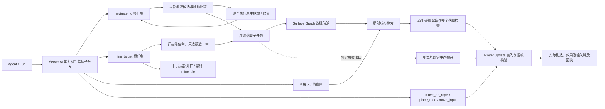

# Terraria 导航系统限制审计

审计基线为 `codex/unified-autonomous-navigation`，实际 HEAD 为 `9c402531d1899c0827c8402a3852d535f415fe6b`，与给定基线一致。审计依据为该工作树中的正式实现、自动化断言和仓库保存的历史验收记录。工作区原有未跟踪设计稿及 `terrabot/` 未用作运行时契约。本轮为只读代码审计，新增本报告，未运行测试、构建或启动游戏。

## 能力覆盖图

| 能力 | 自主 `navigate_to` | 直接导航 / 其他入口 | 已见最高验证等级 |
| --- | --- | --- | --- |
| 干燥走、跳、下落 | 支持有限 profile、动作及落脚窗口。长程靠滚动 Graph | 直接 X 和落脚区使用局部任务。客户端预测控制另走同一模型，无服务器改造编排 | 有隔离原生及部分自然地形记录 |
| 平台、半砖、斜坡 | 有形状识别、原生支撑和预测。平台可上穿，缺少主动下穿 | 站位候选及编辑规则各有额外限制 | 有隔离落脚场景和离线 Graph 覆盖 |
| 二段跳 | 单一 Cloud 模型，采样有限触发时刻 | 同一模型，服从各入口的规划预算 | Cloud 有隔离原生记录 |
| 翼与火箭 | 已建模的普通非悬停翼、基础火箭靴 | 同一模型，无任意空中状态起步规划 | 天使翼、骨之翼有隔离服务器原生飞行记录，火箭靴仍为离线与 IL 证据 |
| 钩爪 | 连续落脚子任务可尝试一次目的地高台模板 | 已挂钩时普通导航拒绝。直接 X / 公开落脚区无该连续回退 | 基础钩模板有双引擎隔离记录 |
| 绳索 | Graph 无绳索边 | `move_on_rope` 独立对齐攀爬，`place_rope` 独立布置 | 独立操作有双引擎隔离记录 |
| 游泳、液体进出 | 无。干燥跨越、绕行、贴水开挖或特定水面搭平台 | 原始输入入口有独立资格和时长边界，完成只证明输入执行 | 已有干燥规避与湿起点拒绝的隔离证据 |
| 坐骑、反重力、特殊移动状态 | 普通资格门拒绝 | 独立入口各有自己的资格，不能由发现字段推导导航支持 | 能力采样或拒绝证据，运动规划待验证 |
| 地形改造 | 同层局部开口、短搭路、对齐下挖。每个子动作核验 | `mine_target` 使用独立站位扫描及局部开口逻辑，原子动作可单独调用 | 隔离场景覆盖若干走挖放组合 |

**入口与结果。** [Python 原子分发](../python/atomic_operations.py#L744) 按握手开放调用，根任务由 [ServerAiNativeActions.Start](../CompanionBridge/ServerIpc/ServerAiNativeActions.cs#L53) 创建。公开直接导航、任务中的连续落脚子任务和客户端预测运动应分别解释。客户端从 [CompanionPlayer 的输入边界](../CompanionBridge/Common/Players/CompanionPlayer.cs#L83) 进入 `GameNavigation.Before/After`。服务器通过 [ServerAiNavigation.Apply/Update](../CompanionBridge/ServerIpc/ServerAiNavigation.cs#L116) 注入原生输入，再以真实状态验收。目标穿越、预测完成、子任务完成和根任务效果核验是不同事件。Agent 所见状态还经过 [Python 回执核验](../python/atomic_operations.py#L646)，缺少输入释放证据时可转为 `unknown`。

## 限制清单

覆盖栏中“离线”表示找到相关测试入口，“原生”表示仓库有历史隔离验证记录，“待验证”表示未找到该具体组合的通过证据。设计目的带“推断”时来自判断逻辑及其调用语境。数值以世界像素和游戏更新为单位，1 Tile = 16 px。源码链接以本次基线行为为准。

### A. 运动资格与动作模型

| 限制名称 | 源码位置 | 触发条件 | 当前数值 | 设计目的 | 限制类型 | 游戏影响 | 测试覆盖 | 初步建议 |
| --- | --- | --- | --- | --- | --- | --- | --- | --- |
| 坐骑与反重力 | [GameNavigation.OrdinaryRejection](../CompanionBridge/Motion/GameNavigation.cs#L37) | mount.Active 或 gravDir != 1。根任务 Prepare 和逐帧 Before 均使用资格 | 正向重力 | 避免套用普通碰撞及加速公式 | 未实现 | 骑乘、重力切换、倒立走跳 | Mobility 离线，发现记录 | 扩展运动模式 |
| 附着状态 | [GameNavigation.OrdinaryRejection](../CompanionBridge/Motion/GameNavigation.cs#L47) | pulley、grapCount 非零 | 0 个挂钩 | 普通模型不接管附着 | 未实现 | 无法从当前攀绳或已挂钩状态接续目标 | 独立绳索、钩爪原生 | 统一模式切换 |
| Web、冰与外力 | [GameNavigation.OrdinaryRejection](../CompanionBridge/Motion/GameNavigation.cs#L50) | webbed、sliding、autoJump、windPushed、slippy/slippy2、sticky、powerrun；石化冻结另拒绝 | 布尔门 | 排除不同摩擦、自动动作及外力，失能时避免输入 | 模型边界与原生失能 | 蜘蛛网移动、冰面滑行、自动跳及部分装备加速均可整段失败 | Mobility 类覆盖，逐状态穿越待验证 | 区分暂时失能与有控制力的替代模型 |
| 湿身及特殊液体标记 | [GameNavigation.OrdinaryRejection](../CompanionBridge/Motion/GameNavigation.cs#L47) | wet，或独立 honeyWet/lavaWet/shimmerWet | 布尔门 | 排除未建模介质与伤害 | 模型与安全 | 水中起步、游泳、湿身脱水均无通用计划 | 液体原生湿起点拒绝 | 扩展水中模型，保留岩浆风险 |
| 物品动画与身体尺寸 | [GameNavigation.OrdinaryRejection](../CompanionBridge/Motion/GameNavigation.cs#L70) | itemAnimation != 0、身体不等于模型、速度非有限 | 20×42 px | 固定姿态模型，避免物品使用边界冲突 | 模型与保守互斥 | 走路时挥镐、移动中使用物品或不同体型失败 | Mobility 离线，真实混合动画待验证 | 细分真实输入互斥 |
| 有效运动参数 | [PhysicsParameters.IsSupportedGroundPhysics](../CompanionBridge/Motion/PhysicsSimulator.cs#L18) · [NativeNavigation.Parameters](../CompanionBridge/Motion/GameNavigation.cs#L77) · [MobilityTracker.Sample](../CompanionBridge/Motion/MobilityProfile.cs#L28) | 加速、速度、重力等需通过参数域检查，profile 修订使路线失效 | Basic 参考 accRun 0.08、maxRun 3、重力 0.4、最大落速 10.01、跳速 5.01、跳跃计数 15；Swiftness 参考 0.1、3.75 | 用当前原生参数预测，固定模型只接受其适用域 | 模型 | 普通地面数值可变，异常参数或执行中改变会拒绝或恢复 | Mobility 原生有药效增删、到期和 ABA | 保留参数核验，扩大有证据的模型域 |
| 二段跳白名单 | [ExtraJumpModel.Select](../CompanionBridge/Motion/ExtraJumpModel.cs#L10) · [GameNavigation.OrdinaryRejection](../CompanionBridge/Motion/GameNavigation.cs#L59) | 唯一启用项须为 Cloud；其他可用或 active 跳跃触发拒绝 | 原跳计数×0.75，取整数 | 用明确原生模型与资源核验 | 未实现 | 多瓶叠加、其他原版与 Mod 跳跃可能连普通导航也进不去 | ExtraJump 离线及双引擎原生 | 按可组合资源扩展 |
| 飞行 profile 白名单 | [AirMotionModel.Select](../CompanionBridge/Motion/AirMotionModel.cs#L23) · [GameNavigation.OrdinaryRejection](../CompanionBridge/Motion/GameNavigation.cs#L62) | 已建模垂直分组的普通翼或基础火箭靴；翼优先；飞行资源须合法；拒绝额外跳跃组合及 slowFall、empressBrooch、chilled；只认 Basic/Swiftness 基础参数 | 参数匹配容差约 0.001，见 Matches | 固定原生资源与推进模型 | 未实现与模型 | 其他翼靴、混装、飞行耗尽后切靴等原生组合缺失 | Air 离线、IL，天使翼与骨之翼已有隔离原生验收 | 其余翼型逐组验证 |
| 输入字母表 | [PhysicsSimulator.Predict](../CompanionBridge/Motion/PhysicsSimulator.cs#L197) · [ServerAiNavigation.Apply](../CompanionBridge/ServerIpc/ServerAiNavigation.cs#L116) | 普通边只生成横向和 Jump，Up/Down 清零，单边通常固定横向方向 | 左、右、部分中立，Jump 开关 | 限制组合规模 | 算法与未实现 | 平台主动下穿、空中多次反向、部分同侧跃迁不在动作空间 | Planner、Vertical 离线，平台原生 | 扩展动作基元 |
| 候选持续时间和触发点 | [StateSpacePlanner.Search.Run](../CompanionBridge/Motion/StateSpacePlanner.cs#L188) · [SafeGroundWalk.TryPlan](../CompanionBridge/Motion/SafeGroundWalk.cs#L13) | 常规 jump hold 每 2 帧取样；普通步行仅两个 stride；中立跳只在目标 X 带内且上升至少 4 px；能力分支抽样释放/激活 | 步行 6/24；平走捷径落脚模式枚举 1–24；Cloud 4 个触发点、间隔 8；翼 8–40 帧五档；靴三档起始时间、一帧触发 | 降低分支 | 算法边界 | 精确短挪、奇数帧跳、窄竖井和特定时机可能漏解 | Planner、Vertical、ExtraJump、Air 离线 | 用反例驱动补充动作 |
| 预测时域和最小位移 | [PhysicsSimulator.Predict](../CompanionBridge/Motion/PhysicsSimulator.cs#L185) · [终止](../CompanionBridge/Motion/PhysicsSimulator.cs#L244) | 预测期内须有连续两帧稳定支撑；非纯刹车还须达最小进展 | 普通 90、Cloud 140、Air 180；方向步行 ≥4、方向跳 ≥24、原地上升 ≥4 px；预测尾部 VX <0.01 | 排除无进展边并为停止留证据 | 算法与预算 | 小跳、短微调及长滞空被筛掉 | Motion、Planner、Air 离线 | 分离到达精度与防循环 |
| 下落上限 | [PhysicsSimulator.Predict](../CompanionBridge/Motion/PhysicsSimulator.cs#L218) · [StateSpacePlanner.MaxDropPixels](../CompanionBridge/Motion/StateSpacePlanner.cs#L19) | 跳按起始 Y，非跳按最近地面 Y。Graph 同样剪去大下降 | 规划 64 px；Predict 默认 16；钩爪尾段 32；编辑另见 C | 限制未验证落点和长落差 | 保守安全与模型 | 无伤下落也会因落差超限，装备减伤不改变该上限 | Motion、Vertical、自然下降及安全失败原生 | 建模原生跌落风险再调整 |
| 碰撞窗口和单帧速度 | [NativeMotionWorld.Check/MoveCore](../CompanionBridge/Motion/NativeMotionWorld.cs#L67) | 试算扫掠超出以起点建立的窗口，或任一速度分量超限 | 45×29 Tile，分量 32 px/更新 | 本地数据和原生碰撞查询留边界 | 算法与防护 | 长边、高速、被击退的合法轨迹可被截断 | Motion、Graph 离线，真实高速待验证 | 按轨迹滚动覆盖 |

### B. 地形、落脚、搜索及执行

| 限制名称 | 源码位置 | 触发条件 | 当前数值 | 设计目的 | 限制类型 | 游戏影响 | 测试覆盖 | 初步建议 |
| --- | --- | --- | --- | --- | --- | --- | --- | --- |
| 未加载和特殊 Tile | [TerrainReader.Loaded/ReadDryShape](../CompanionBridge/Common/Systems/TerrainReader.cs#L56) · [TerrainClassifier.Classify](../CompanionBridge/TerrainSnapshot.cs#L78) · [NativeMotionWorld.Check](../CompanionBridge/Motion/NativeMotionWorld.cs#L67) | 边界、未加载客户端区段、超原版类型或未识别形状归 `?`；已识别伤害归 `!`；扫掠触及即停 | 客户端需已加载区段，地图边界余量 1 Tile | 避免盲走与碰伤 | 信息不足与安全共用拒绝路径 | 可能拒绝实际无害 Mod Tile 或客户端区段边缘 | Perception、Liquid、Graph 离线 | 区分待加载、未建模、已知伤害 |
| 液体扫掠 | [NativeLiquidRisk.Rejection](../CompanionBridge/Motion/NativeLiquidRisk.cs#L13) · [NativeMotionWorld.SafeSweep](../CompanionBridge/Motion/NativeMotionWorld.cs#L80) | 扫掠覆盖未知拒绝；岩浆走原生碰撞判定；蜂蜜、微光、未知液体有额外形状重叠判定；沿轨迹复核 WetCollision | 采用液面/碰撞采样 | 避免损伤与未建模介质接触 | 安全与模型 | 水浅仍可因湿碰撞拒绝；附近有水但干燥轨迹仍可能通过 | Liquid 离线，干跳和岩浆原生 | 保留接触区分，验证浅水和流动边界 |
| 原生碰撞和平台语义 | [NativeMotionWorld.MoveCore](../CompanionBridge/Motion/NativeMotionWorld.cs#L97) · [TerrainClassifier.SurfaceOffset](../CompanionBridge/TerrainSnapshot.cs#L98) | 原生裁剪、斜坡及 step assist；平台按单向支撑，识别半砖和多类斜坡；形状/碰撞不一致可不产生站位 | 半砖高差 8 px | 复用 Terraria 实际阻挡 | 原生规则与近似 | 实体墙、头顶碰撞是真约束。平台下穿缺失来自输入模型 | Landing、Surface 离线及隔离落脚 | 保留原生裁剪，增加差分验证 |
| 原生落脚检查 | [NativeMotionWorld.ContactRejection/LandingRejection](../CompanionBridge/Motion/NativeMotionWorld.cs#L168) | Grounded、原位安全扫掠、原生支撑及净空需通过 | 0.125 px 接触探针 | 实际支撑确认 | 安全 | 普通导航接受部分脚底悬空；未知扫掠或支撑不可靠拒绝 | Landing 离线和部分原生 | 保留原生确认，测试边缘精度 |
| 虚拟落脚与平面带 | [MotionSupport.CheckLanding](../CompanionBridge/Motion/MotionSupport.cs#L90) · [LocalEditGeometry.LandingBand](../CompanionBridge/Motion/LocalTerrainPlanning.cs#L51) | 虚拟落脚扫描足部上下带，任一扫到 `?`/`!` 即失败；接触宽度须 >0；编辑还要求平面左右偏移均安全 | 脚底 ±0.5 px；扫描 bottom−16 到 bottom+4；站位偏移 ±2 px | 编辑前验证新地形与容错 | 安全及保守几何 | 原生能站住的窄台、斜坡、边缘有时不能作为编辑站位 | Landing、LocalTerrain 离线 | 用同一接触语义，保留可解释余量 |
| 到达和检查点资源门 | [LandingRegion.AtDestination/Arrived](../CompanionBridge/Motion/MotionSupport.cs#L12) · [PhysicsSimulator.SupportedCheckpoint](../CompanionBridge/Motion/PhysicsSimulator.cs#L86) | 脚底覆盖目标点且停稳。检查点要求 grounded、释放 Jump、跳计数清零、无 active extra 或火箭延迟帧 | 左边界 [x−20,x]，脚底 ±0.5，停稳 VX/VY ≤0.1；X-only 方向阈值 12 px | 成功回执与可重规划状态确定 | 安全与算法 | 空中经过目的地、短暂停靠、尚在火箭恢复期都不算到达或可交接 | LandingConfirmation、Air 离线，落脚原生 | 保留成功核验，扩大中间状态 |
| 空中启动及改计划 | [NavigationTask.Before](../CompanionBridge/Motion/NavigationTask.cs#L150) · [LocalMotionController.Before](../CompanionBridge/Motion/LocalMotionController.cs#L77) · [NativeNavigationWorld.Evaluate](../CompanionBridge/ServerIpc/NativeNavigationWorld.cs#L131) | 直接规划要求 grounded；自主评估等待实际 settled；执行偏差先放键等待落地 | jump 已释放且计数 0 | 避免从未证明状态接续 | 算法边界 | 跳到半空时变向、从跌落中救回、湿身离水后即时规划困难 | Recovery、LandingConfirmation，空中偏差原生 | 支持可证明空中接续 |
| 局部状态跨度与预算 | [StateSpacePlanner.Plan/Advance](../CompanionBridge/Motion/StateSpacePlanner.cs#L36) · [状态预算](../CompanionBridge/Motion/StateSpacePlanner.cs#L180) · [边界](../CompanionBridge/Motion/StateSpacePlanner.cs#L243) | 从当前起点剪去跨度外状态；只有严格相同物理状态被低成本标签支配；独立计划单次推进 | 普通 ΔX 192/ΔY 128；Cloud/Air 288/208；默认 32 expansions、25 ms、8192 状态 | 限制本地计算 | 预算与算法 | 有路但需要先向反方向走远、更多搜索或更长高差时可能只给前缀/失败 | PlannerCorrectness、NavigationTrip 离线 | 预算退出保留可续状态，度量遗漏 |
| Graph 范围和节点 | [SurfaceGraph.Refresh](../CompanionBridge/Motion/SurfaceGraph.cs#L76) · [SurfaceNavigator.Run](../CompanionBridge/Motion/SurfaceGraph.cs#L296) | 以实站位扩展局部矩形；Graph 达上限结束该次搜索 | 横向半径 24/48/96/128 Tile；纵向半径 min(64,max(16,r/2))；8192 节点；默认 512 工作单元/4 ms，编辑比较 3 ms | 控制游戏线程开销 | 预算 | 密集斜坡或大绕行可在连通路径存在时停止 | SurfaceGraph 有滚动与节点耗尽；真实密集地图待验证 | 稀疏表示与可续前沿 |
| Graph 站位采样 | [SurfaceGraph.Refresh/GoalStances/KeySample](../CompanionBridge/Motion/SurfaceGraph.cs#L115) | 只对已知支撑形状建图；整数位置采样并要求静止 pose 单步保持；连续平地采稀疏点，斜坡站位不合并 | 左边缘偏移 −19..15 px；普通平地起点 48、目标 64 px 内保留 | 减少节点，预筛可停稳姿态 | 算法 | 亚像素缝、临时过渡接触与未抽到的跳点可能消失 | SurfaceGraph 离线；亚像素自然场景待验证 | 保留区间与动态接触候选 |
| Graph 候选连接和局部验证 | [SurfaceGraph.Candidate](../CompanionBridge/Motion/SurfaceGraph.cs#L214) · [SurfaceNavigator.Run](../CompanionBridge/Motion/SurfaceGraph.cs#L373) | 粗剪水平距离和升降；只验证当前候选首段，Graph 判作 Jump 时强制第一步跳；失败可对目的节点做本次拒绝 | 横向 144/256 px；下降 64；上升为跳速/计数/重力公式加能力余量；物理分片 8 expansions，32 用于部分结果比较 | 将宏观图限制在可验证动作附近 | 算法 | 需要先助跑或另一发射点才能到同一节点的路线可漏检 | SurfaceGraph、Vertical、Air 离线 | 让拒绝绑定边和发射姿态 |
| 短平走捷径 | [NavigationTask.Before](../CompanionBridge/Motion/NavigationTask.cs#L179) · [SafeGroundWalk.TryPlan](../CompanionBridge/Motion/SafeGroundWalk.cs#L13) | 已启用且距离合适才试；保持近似同高、无过冲，须走出更近检查点或完成刹车 | Graph 模式距离 ≤64 px；过冲门 12 px | 加速平地和精确收尾 | 算法捷径 | 不满足会转正式搜索；增加额外同高限制的是该捷径 | Planner、Trip 离线 | 保留捷径，观察回退成本 |
| 逐帧误差与边复用 | [LocalMotionController.Before/After](../CompanionBridge/Motion/LocalMotionController.cs#L105) · [NavigationTask.TryContinue](../CompanionBridge/Motion/NavigationTask.cs#L407) | 重算下一步及扫掠；位姿/速度或能力资源误差使路线偏离；续边从真实态重预测并比较终点 | 前置位置误差门 6 px；坏帧累计 2 或单帧误差 >16；续边终点位置比较约 0.01 px | 不盲目重放过时输入 | 安全与模型容差 | 轻微地形变化、边界舍入、资源抖动可频繁重算或触发恢复 | Recovery、Air、ExtraJump，位移注入原生 | 区分失效与仍可验证的偏差 |

### C. 改造、接近挖掘目标及独立动作

| 限制名称 | 源码位置 | 触发条件 | 当前数值 | 设计目的 | 限制类型 | 游戏影响 | 测试覆盖 | 初步建议 |
| --- | --- | --- | --- | --- | --- | --- | --- | --- |
| 原生挖掘资格 | [ActorMining.FindTool/原生判定](../CompanionBridge/ServerPlayerRuntime/ActorMining.cs#L100) · [NativeMineTargetWorld.Prepare](../CompanionBridge/ServerIpc/NativeMineTargetWorld.cs#L31) | 校验绑定和健康，CanKillTile、镐/斧力、原生范围及工具；目标解析需有效 tile | 主背包前 50 格 | 保留原生交互限制 | 原生规则及工具选择范围 | 不够镐力、被保护、超距不能挖；这些失败不应靠导航放宽 | MineTarget、原生工具 | 保留 |
| 目标站位扫描及单候选 | [NativeMineTargetWorld.FindApproach](../CompanionBridge/ServerIpc/NativeMineTargetWorld.cs#L77) · [AutonomousNavigationTask.Tick](../CompanionBridge/ServerIpc/AutonomousNavigationTask.cs#L86) | 站位需原生落脚、移除目标后虚拟支撑及工具可及；只返回距离最近的一带，未按可达性比较其他带 | X 从 (x−6)×16−10 到 (x+7)×16−10，步长 1 px；脚底 Y ±6 Tile、步长 8 px | 找可挖站位，兼容窄偏移 | 算法与预算 | 可达的另一侧站位被挡住的近点淘汰；部分斜坡高度漏采；当前 NativeMotionWorld 窗口还可截掉远站位 | HEAD 有 fixture/断言，替代候选与远窗待验证 | 返回有界排序候选并比较路由 |
| 站在目标上挖 | [NativeMineTargetWorld.SafePose/CanMine](../CompanionBridge/ServerIpc/NativeMineTargetWorld.cs#L57) | 虚拟去除目标及家具组成格后仍有支撑；仅已改造、非家具、非到达检查且能证明下降时允许例外 | 按编辑落差上限 | 防目标挖除导致失足 | 安全与保守模板 | 即使原生可挖并能安全落地，初次直接站在该块上也可能被拒绝 | MineTarget、MiningSupport 离线与部分原生 | 证明移除后轨迹而非依赖已编辑标志 |
| 旧式开口限制 | [NativeMineTargetWorld.FindOpening](../CompanionBridge/ServerIpc/NativeMineTargetWorld.cs#L116) · [NativeNavigationEdits.FindOpening/PlanAcross](../CompanionBridge/ServerIpc/NativeNavigationEdits.cs#L55) | 只为普通镐目标开路，frame-important 目标无开口；已可及而移除邻居不安全时拒绝。先试低处步落，随后要求平坦且 Tile 对齐；对齐向上无开路 | 非滚动窗口横 12、纵 8 Tile | 限定挖掘任务附带改造 | 保守安全与模板 | 不能为家具、树等目标自动清出路线，或挖台阶向上逼近 | MineTarget 原生含局部开口 | 复用多候选安全编辑评估 |
| 自主编辑模板和预算 | [LocalEditEvaluation.Advance/Run](../CompanionBridge/Motion/LocalTerrainPlanning.cs#L175) · [NativeNavigationWorld.FindOpening](../CompanionBridge/ServerIpc/NativeNavigationWorld.cs#L101) | 只从平坦、脚底整 Tile、静止站位生成；按目标方向逐 Tile 前进；或目标横向对齐且在下方时试下挖。只执行选中计划首个动作 | 4 步，18 格改造/局部评估；64 工作单元/3 ms；整 Tile 容差约 0.16 px | 有界评估并每次实地复核 | 算法模板与预算 | 缺任意向上搭阶、绕向开挖、跨高度联合编辑；较长工程靠滚动 | LocalTerrain 离线、自主编辑原生 | 扩展基元与有界搜索 |
| 编辑候选选择 | [LocalEditEvaluation.Choose](../CompanionBridge/Motion/LocalTerrainPlanning.cs#L195) · [NativeNavigationWorld.Evaluate](../CompanionBridge/ServerIpc/NativeNavigationWorld.cs#L155) | 比较局部编辑与 Graph 移动估价；优先开口候选，完整绕行排除未完成编辑与水面平台；部分路线在特定距离比较下被放弃 | 编辑成本需至少优 8；材料×8、改造×4，另计步行、工具时间和剩余距离 | 限制不必要改造 | 启发式与安全 | 不能保证最少改造或最短路；运动比较遇未知/节点预算时可阻断编辑选择 | LocalTerrain、TaskRuntime 离线，干燥绕行原生 | 记录可比的代价与局部不确定性 |
| 自主可切格和邻域 | [NativeNavigationEdits.Mine/SafeExcavation/SafeRemovalNeighbours](../CompanionBridge/ServerIpc/NativeNavigationEdits.cs#L231) · [邻域与锚点](../CompanionBridge/ServerIpc/NativeNavigationEdits.cs#L339) | 只切已知实心、未虚拟改过的普通镐格，保护目标、危险、frame-important、落沙、可能受影响家具锚点；还需原生工具资格 | 按局部邻域及 TileObjectData 锚点 | 避免破坏家具、引发坍落和危险 | 安全与模板 | 原生可挖的半砖、斜坡、平台、落沙或家具邻格可被排除；最新邻域逻辑允许部分安全植被和独立锚点 | LocalTerrain 与 MineTarget fixture，复杂锚点待验证 | 保留明确风险，按因果检查扩展 |
| 编辑后的下落 | [NativeNavigationEdits.DropBudget/LandingAfterCut](../CompanionBridge/ServerIpc/NativeNavigationEdits.cs#L185) · [LocalEditGeometry.FallLanding](../CompanionBridge/Motion/LocalTerrainPlanning.cs#L98) | 虚拟去除候选后要求证明固定姿态安全下降或保留支撑；活体落地另观察 | ≤64 px 并受开口起点累计深度约束；静止容差 0.01 | 防挖穿后无支撑 | 安全与模型 | 需要挖后主动转向、连续长落差或半空接续的开口失败 | LocalTerrain、MiningSupport、原生局部开口 | 扩展可验证挖后动作 |
| 自主放置材料和位置 | [NativeNavigationEdits.Materials/Place](../CompanionBridge/ServerIpc/NativeNavigationEdits.cs#L202) · [LocalEditEvaluation.Run](../CompanionBridge/Motion/LocalTerrainPlanning.cs#L236) | 材料仅快捷栏的安全整块或原版平台；禁止目标占用、危险邻域、放置受限状态、超出原生交互范围；每分支单材料并选择首个通过放置格 | 0–9 槽，步进 16 px | 保守放置且可逐件确认 | 原生规则与模板 | 背包有料仍可能缺料，混材桥、先铺多格才能跨越的空洞、需跨层放置可能漏解 | LocalTerrain、自主放置原生 | 有界多候选，显式处理材料调度 |
| 水上桥接 | [LocalEditGeometry.WaterDeckCell](../CompanionBridge/Motion/LocalTerrainPlanning.cs) · [NativeNavigationEdits.WaterPlacementStillSafe](../CompanionBridge/ServerIpc/NativeNavigationEdits.cs) | 逐列核验普通水、头顶净空、依附点、库存、交互范围及行走支撑 | 局部向前规划，原生操作后重新观察 | 保持身体干燥及可返回支撑 | 安全与专用模板 | 斜岸起桥和特殊液体仍受限 | 普通水长池原生回归 | 验证更多天然岸形 |
| 编辑授权失效 | [NativeNavigationEdits.Arm/RevalidateOpening](../CompanionBridge/ServerIpc/NativeNavigationEdits.cs#L282) · [执行前复核](../CompanionBridge/ServerIpc/NativeNavigationEdits.cs#L390) | 动作起点须匹配；工具/材料/库存、格子形态修订、人物站位或安全变化使编辑失效 | 重核起点，开挖位置比较约 0.1 px | 防过期世界与错物品写入 | 安全与一致性 | 地形或库存波动时计划反复重算；部分情况无法立刻换工具 | TaskRuntime、取消/目标变化原生 | 保留身份与效果约束，跟踪失效原因 |
| 钩爪选型和触发 | [NavigationTask.Before](../CompanionBridge/Motion/NavigationTask.cs#L224) · [ServerAiNavigation.TryGrapple](../CompanionBridge/ServerIpc/ServerAiNavigation.cs#L75) · [ActorGrapple.Selected/Fire](../CompanionBridge/ServerPlayerRuntime/ActorGrapple.cs#L107) | 连续落脚、覆盖内无路或安全前缀无上升；指定基础 Hook、当前未挂钩、资格和 projectile 槽可用 | 每个根行程最多一次；预检找不到模板尚不消费 | 保守原生回退 | 未实现与安全 | 已挂钩、其他钩种、连续换钩或为中间路段布钩未纳入图 | Grapple 离线与双引擎原生 | 把钩爪边纳入可搜索运动图 |
| 钩爪几何和阶段窗口 | [GrappleClimbPlan.Find/Tail](../CompanionBridge/Motion/GrappleClimbPlan.cs#L18) · [ServerGrappleClimb.Before/After](../CompanionBridge/ServerIpc/ServerGrappleClimb.cs#L29) | 仅干燥竖井、普通或 Swiftness、指定整砖目标与实心锚；验证真实附着和松钩后上升尾段 | 上升 144–192、横距 32–112、射程 280 px；锚点 X 偏差 ≤2，Y 高于台面 7–9 Tile；释放参考 64 px；尾段 stride 8–48 步长 2；发射期限 35、拉升 42、全程 145 帧，拉不动 5 帧 | 限定已验证原生模型 | 专用模板与安全 | 横向摆荡、斜拉、中继钩、矮台和带平台/液体的落脚均可排除 | Grapple 原生含偏射、取消、锚点变化 | 泛化锚点和交接边，保留原生归属核验 |
| 绳索移动和退出 | [ServerAiRope.Start/Continuous/LandingSupported](../CompanionBridge/ServerIpc/ServerAiRope.cs#L30) · [执行判定](../CompanionBridge/ServerIpc/ServerAiRope.cs#L183) · [AtomicParameters](../CompanionBridge/AtomicParameters.cs#L183) | 身体尺寸/重力和干燥等资格；初始速度小、中心在同列、头附近连续绳段、通道干净。落地模式仅下行且原生离绳后安全停稳 | VX/VY ≤0.1；目标距 ≤384 px；末端落差 ≤32 px；整 Tile 实心落脚；1–360 更新，20 更新附着/停滞门，连续 2 帧确认 | 验证已对齐直线攀爬 | 专用模板及安全 | 跳向绳索、攀到平台后侧向离开、跨列转移和长绳单次执行受限 | RopeMotion 双引擎原生及回执离线 | 加入接近、附着和多出口边 |
| 绳索放置 | [ActorRope.Select/Validate](../CompanionBridge/ServerPlayerRuntime/ActorRope.cs#L8) | 原版四类绳材料，快捷栏选取；已有绳只能同列向下找到空格；点击与落点都须原生可及，拒非水液体 | 单次向下查找最多 16 段；InWorld 余量 5 Tile | 限定可确认的原生材料和放置效果 | 原生约束与保守范围 | 背包绳需先调入快捷栏；深绳、复杂介质、自动布绳通路缺失 | Rope 双引擎原生 | 保留原子核验，独立扩展规划能力 |

### D. 恢复、失败语义及生命周期

| 限制名称 | 源码位置 | 触发条件 | 当前数值 | 设计目的 | 限制类型 | 游戏影响 | 测试覆盖 | 初步建议 |
| --- | --- | --- | --- | --- | --- | --- | --- | --- |
| 伤害和敌人中止 | [NativeNavigationWorld.CheckHazards](../CompanionBridge/ServerIpc/NativeNavigationWorld.cs#L61) · [GameNavigation.Before/After](../CompanionBridge/Motion/GameNavigation.cs#L113) | 生命低于基准、lavaWet、近距离活跃非友善且 damage>0 的 NPC；未做通路、视线或攻击可达性比较 | NPC 中心距离 ≤160 px | 中断危险任务 | 安全及保守风险代理 | 隔墙敌人、低损伤通路和作战中的移动会被打断 | TaskRuntime 与危险夹具，隔墙矩阵待验证 | 保留伤害终止，验证敌人判据 |
| 普通行程和墙钟限额 | [NavigationTripProgress](../CompanionBridge/Motion/NavigationTripProgress.cs#L9) · [NavigationTask.Before/CheckBudgets](../CompanionBridge/Motion/NavigationTask.cs#L150) · [AiAtomicActions](../CompanionBridge/ServerIpc/AiAtomicActions.cs#L130) | 非连续任务耗尽更新、搜索、累计规划或动作预算；单次 native 导航预测超 50 ms 在非连续模式失败 | 1800 更新，128 搜索，3200 ms 累计，256 动作；公开直接 30 s；根任务 55 s IPC 上限 | 防长时间占用和主线程卡顿 | 预算 | 大绕行、低帧率、慢机或长坡路受不同预算提前终止 | Trip、TaskRuntime 离线 | 给预算退出独立语义并统一计量 |
| 根任务及子动作期限 | [AutonomousNavigationTask.Tick/StartChild](../CompanionBridge/ServerIpc/AutonomousNavigationTask.cs#L140) · [TaskRuntime.RunChild](../CompanionBridge/ServerIpc/TaskRuntime.cs#L104) · [ServerAiNativeActions.Start](../CompanionBridge/ServerIpc/ServerAiNativeActions.cs#L53) | 首次创建子槽的预算确定 deadline，后续 Tick 的参数不会重置；根任务截止仍生效 | 根 2700 更新，目标落脚子任务 2700，编辑位移 360，挖/放 600，编辑后静止确认 90 | 上界明确，防串行子任务无期限 | 预算 | 慢挖、重复恢复、跨区滚动及安全长落地可先超时 | TaskRuntime 离线、原生取消；交叠期限待验证 | 统一报告实际生效的截止 |
| 检查点和停滞 | [NavigationTripProgress.Reject/Checkpoint](../CompanionBridge/Motion/NavigationTripProgress.cs#L29) · [NavigationProgressWatchdog.Observe](../CompanionBridge/Motion/NavigationProgressWatchdog.cs#L9) · [NavigationTask.CheckBudgets](../CompanionBridge/Motion/NavigationTask.cs#L328) | 重复姿态按量化键剪枝；非连续只容纳有限偏离；连续以已验证新检查点/效果复位，观察到移动距离仅做诊断 | 重复键两次后拒绝；距离改善门 4 px；非连续 detour 6、连续活动更新 180；非连续 4 次 stalled | 阻止原地循环 | 算法与预算 | 往返助跑、暂时反向绕行或需要更多活动更新的路线可能提前停止 | Trip、Recovery 离线与偏移原生 | 用路径阶段/拓扑进展减少误判 |
| 恢复次数与中立窗口 | [NavigationTask.BeginRecovery/ObserveRecovery](../CompanionBridge/Motion/NavigationTask.cs#L451) · [ConfirmLanding](../CompanionBridge/Motion/NavigationTask.cs#L359) | 路线偏离后放键，要求真实安全且两帧静止。连续成功检查点才可清连续次数。无法确认落地或释放进入 unknown | 非连续累计 3，连续连续 3；确认及恢复各 60 更新；确认落脚偏移 X≤8、Y≤4 px | 停止失配输入，重新从事实出发 | 安全与固定策略 | 多处连续小偏差或长落体可能用尽额度；没有主动空中纠偏通用路径 | Recovery、LandingConfirmation，注入式原生偏移 | 保留释放确认，区分恢复风险和重试策略 |
| 失败记忆与重新尝试 | [NavigationFailureMemory](../CompanionBridge/Motion/NavigationFailureMemory.cs#L11) · [NavigationKnowledge](../CompanionBridge/Motion/NavigationKnowledge.cs#L35) · [NavigationTask.Before](../CompanionBridge/Motion/NavigationTask.cs#L195) | 失败边按起点/轨迹及签名排除；地形/profile/有效期改变会失效；执行搜索光标也随状态或失败版本重建 | 失败边容量 64、有效期 120 更新；规划知识容量 256、有效期 120 | 防重复，允许世界变化后重试 | 算法与预算 | 可以挡住近期同类失败；变更后可能重复同策略，结束的空预算搜索也可能被重建 | Recovery、SurfaceGraph 离线；同场景反复预算退出待验证 | 区分环境变更、预算耗尽、真实失败 |
| 重复改造与重规划上限 | [AutonomousNavigationTask.Tick](../CompanionBridge/ServerIpc/AutonomousNavigationTask.cs#L70) · [settling](../CompanionBridge/ServerIpc/AutonomousNavigationTask.cs#L119) · [NativeNavigationWorld.CheckpointKey](../CompanionBridge/ServerIpc/NativeNavigationWorld.cs#L49) | 开工前变化或水上放置变化重新规划；重复完全相同姿态及局部地形签名终止 | 连续失效 8；保存 64 检查点键，同键第 3 次失败 | 防反复尝试和副作用循环 | 安全与预算 | 动态世界快速变化可过早耗尽；每次编辑改变签名时重复目的未必命中同键 | TaskRuntime、LocalTerrain；动态循环待验证 | 按效果与可达前沿定义进展 |
| 失败后能否编辑 | [ServerAiNativeActions.Poll](../CompanionBridge/ServerIpc/ServerAiNativeActions.cs#L157) · [AutonomousNavigationTask.CanOpenAfterNavigation](../CompanionBridge/ServerIpc/AutonomousNavigationTask.cs#L171) | 仅 failed、已释放、真实停稳和 recoveryKind 为 no_route/no_progress；已经处于开口模式则直接结束失败 | 一条固定回退判定链 | 防未知动作后写世界 | 安全与策略 | 资源退出、执行失配或开口子路径失败不自动改试其他候选 | TaskRuntime 离线与 unknown 原生 | 保留 unknown 阻断，允许已确认失败后选择不同路线 |
| 未知和预算终态 | [SurfaceNavigator.Run](../CompanionBridge/Motion/SurfaceGraph.cs#L429) · [NavigationTask.Before](../CompanionBridge/Motion/NavigationTask.cs#L233) · [NativeNavigationWorld.Evaluate](../CompanionBridge/ServerIpc/NativeNavigationWorld.cs#L164) | 无边时 Graph 可返回节点预算、局部预算、覆盖未知或覆盖内无路；连续空时间片续跑，已结束的预算搜索丢弃；无编辑候选根任务终止 | 同上述各搜索预算 | 区分资源、观测与路线失败 | 预算与结果语义 | Agent 会收到局部失败或超时，即使预算外存在可行路；覆盖中任意残余 `?` 可让无路线结果升级为未知 | SurfaceGraph、TaskRuntime 离线 | 保留结构化边界和下一步可探索前沿 |
| Actor 绑定、取消及回执 | [ServerAiNavigation.Stop/Update](../CompanionBridge/ServerIpc/ServerAiNavigation.cs#L131) · [TaskRuntime.Stop](../CompanionBridge/ServerIpc/TaskRuntime.cs#L118) · [Python 结果核验](../python/atomic_operations.py#L681) | 绑定失效、Actor 死亡、输入释放或效果无法核验；旧连接/任务不得重新驱动输入 | 输入释放与世界/代次/Actor 证据 | 控制权和结果一致性 | 安全 | 移动可能已产生效果但只能报告 unknown；自动重放受阻 | 原生取消/退役/代次、IPC 与 Python | 保留 |

| 限制名称 | 源码位置 | 触发条件 | 当前数值 | 设计目的 | 限制类型 | 游戏影响 | 测试覆盖 | 初步建议 |
| --- | --- | --- | --- | --- | --- | --- | --- | --- |
| 观察目标失效 | [SceneMineTargets.Resolve](../CompanionBridge/ServerIpc/SceneMineTargets.cs#L47) · [NativeMineTargetWorld.Revalidate](../CompanionBridge/ServerIpc/NativeMineTargetWorld.cs#L47) | 目标令牌绑定 Actor、世界代次、完整字段、形态/修订和时效。执行前复核原工具和目标 | 缓存 256 目标、512 修订，观察年龄上限 600 更新，另有墙钟期限 | 防跨世界或陈旧目标 | 一致性与预算 | 长间隔或大量观察后需重新获取目标，工具变化可中断 | Scene/TaskRuntime、原生目标变化 | 保留，明确回执中的重新观察需求 |
| Agent 层终止 | [Python 原子分发/监督](../python/atomic_operations.py#L867) · [Lua 契约](../python/lua_agent.py#L44) | 动作未完成且宿主未允许继续时停止本次 Lua 程序。未知结果不重放 | 原子墙钟、任务截止及 Lua 预算 | 保持释放与副作用核验 | 安全与外层预算 | 局部搜不到也可终止整段 Agent 编排 | Python IPC、Lua 回执及失败屏障 | 保留未知屏障，提供可操作的规划失败信息 |

| 引擎适用版本 | [EngineProfiles.Verify](../CompanionBridge/ServerPlayerRuntime/EngineProfiles.cs#L28) · [EngineHooks](../CompanionBridge/ServerPlayerRuntime/EngineHooks.cs#L41) | 原生挂钩须通过引擎和挂钩指纹 | 以包内 EngineProfiles 为准 | 保证输入、同步和 Actor 隔离依赖的 IL 位置 | 运行环境防护 | 未知引擎无法启用这条服务器控制链 | 双引擎 IL/原生记录 | 保留 |
| 探索 helper 前置剪枝 | [explore.lua 候选](../python/lua/explore.lua#L95) · [分发](../python/lua/explore.lua#L180) | 单独的 Lua 几何先筛，再调用 navigate_to_x。要求已支撑且适用、每列净空，拒绝未知/危险及过大起伏或沟宽 | 默认 6 步/128 px 步幅/768 px 总距，上限 8/128/1024；每方向最多 3 个距离、2 次反向；地表变化 ≤2 Tile、沟宽 ≤3 Tile；敌人裕量 236 px | 有界探索和敌人间距 | 外层算法与安全代理 | 可能在普通导航前以无安全方向、回访或敌人过近终止。直接 navigate_to 不经过此 helper | Lua 探索自动化，真实复杂路线待验证 | 复用可证明的规划前沿 |
| 低层原始移动 | [AtomicParameters](../CompanionBridge/AtomicParameters.cs#L176) · [ServerAiDirectInput](../CompanionBridge/ServerIpc/ServerAiDirectInput.cs#L30) | 原始输入须取得互斥控制、符合独立状态资格并受时长限制 | 1–600 更新，Jump 按住不超过动作更新数 | 提供可核验的有限输入 | API 与生命周期 | 可表达 Up/Down 和空中输入，但没有路线、安全或位移保证 | 原生输入/取消夹具 | 保持能力与规划结果独立 |

## 重点问题判定

1. **普通移动覆盖不完整。** 干地走跳和短下降有原生碰撞核验。主动平台下穿、受控空中换向、任意空中重规划和湿身出入水仍有缺口。64 px 是策略上限，不能当作 Terraria 的跌落伤害阈值。实体碰撞、不可及交互、保护块和工具强度不足有原生规则依据。 [物理预测](../CompanionBridge/Motion/PhysicsSimulator.cs#L185) · [原生碰撞](../CompanionBridge/Motion/NativeMotionWorld.cs#L97) · [原生挖掘](../CompanionBridge/ServerPlayerRuntime/ActorMining.cs#L100)
2. **坐骑、钩爪和绳索未进入通用搜索。** 普通资格排除骑乘和附着。基础钩只在连续落脚的指定失败或低进展出口尝试高台模板。绳索由另一 Driver 独立执行。Cloud、翼和火箭靴属于有限动作枚举。 [资格门](../CompanionBridge/Motion/GameNavigation.cs#L37) · [钩爪入口](../CompanionBridge/ServerIpc/ServerAiNavigation.cs#L65) · [原子动作分发](../CompanionBridge/ServerIpc/ServerAiNativeActions.cs#L60)
3. **通用骨干与多个专用模板并存。** Graph 和局部状态搜索可以处理未预设的普通地形。基础钩竖井、同列绳索、平水面平台、同层开口和对齐下挖分别使用专门几何。缺少能把这些动作连成混合路径的共同搜索。 [Graph](../CompanionBridge/Motion/SurfaceGraph.cs#L287) · [钩爪模板](../CompanionBridge/Motion/GrappleClimbPlan.cs#L18) · [编辑枚举](../CompanionBridge/Motion/LocalTerrainPlanning.cs#L205)
4. **局部失败会终止任务，源码没有全局不可达证明。** 连续搜索可以扩展覆盖、交付安全前缀或在满足条件时转入编辑。前沿耗尽、唯一挖掘站位走不到或编辑被拒时，整次任务可失败。Lua 的失败屏障让这成为本次 Agent 执行的实际终点。 [Graph 退出](../CompanionBridge/Motion/SurfaceGraph.cs#L429) · [根任务终态](../CompanionBridge/ServerIpc/AutonomousNavigationTask.cs#L140) · [挖掘站位](../CompanionBridge/ServerIpc/NativeMineTargetWorld.cs#L77) · [Lua 契约](../python/lua_agent.py#L44)
5. **未知和危险在许可判断处部分合流。** 扫掠和虚拟落脚都拒绝两者。Graph 在无路时检查整个局部覆盖，任意残余未知可使终态走 unknown，即使该格不在某个已考虑的走廊。实际影响频率待验证。 [扫掠](../CompanionBridge/Motion/NativeMotionWorld.cs#L67) · [支撑](../CompanionBridge/Motion/MotionSupport.cs#L90) · [覆盖检查](../CompanionBridge/Motion/SurfaceGraph.cs#L432)
6. **安全检查有不同严格度。** Graph 先筛离散净空，再验原生接触和单步稳定。编辑另外要求虚拟平面站位带、锚点保护，并在动作前复验。窄台可满足原生接触却过不了编辑门。普通移动支持坡面，挖掘候选却只扫描 8 px 脚底高度。干燥地站在水上平台和拒绝湿身游泳并不冲突。 [Graph 站位](../CompanionBridge/Motion/SurfaceGraph.cs#L125) · [编辑站位](../CompanionBridge/Motion/LocalTerrainPlanning.cs#L51) · [挖掘站位](../CompanionBridge/ServerIpc/NativeMineTargetWorld.cs#L87)
7. **恢复有提前结束和重复搜索两类边界。** 三次恢复和 60 更新是固定边界。近期失败边有抑制机制，未结束的连续搜索保留光标。已经结束且无动作的预算搜索会被丢弃，相同输入条件下可能再次建立。实际重复频率待验证。根任务 watchdog 记录进展，180 个活动更新的停滞门在 NavigationTask，纯搜索仍受任务期限。 [恢复计数](../CompanionBridge/Motion/NavigationTask.cs#L451) · [预算出口](../CompanionBridge/Motion/NavigationTask.cs#L233) · [watchdog](../CompanionBridge/Motion/NavigationProgressWatchdog.cs#L25) · [根任务观测](../CompanionBridge/ServerIpc/AutonomousNavigationTask.cs#L112)

## 优先处理的 10 项问题

排序综合正常玩法影响、调用频率及可验证性。调用频率为工程判断，暂无真实世界成功率样本。

| 优先级 | 问题与改进方向 | 源码证据 |
| --- | --- | --- |
| 1 | **挖掘站位只选最近带。** 保留多个站位，先比较可达性，再考虑改造。 | [站位扫描](../CompanionBridge/ServerIpc/NativeMineTargetWorld.cs#L77) → [任务决策](../CompanionBridge/ServerIpc/AutonomousNavigationTask.cs#L146) |
| 2 | **固定 64 px 落差脱离实际伤害与保护。** 为可证明安全的原生下降建立风险模型。 | [预测](../CompanionBridge/Motion/PhysicsSimulator.cs#L218) → [图剪枝](../CompanionBridge/Motion/SurfaceGraph.cs#L214) |
| 3 | **局部失败和预算耗尽缺少可继续的前沿。** 保存有效前缀和预算原因，减少相同空搜索重建。 | [Graph 物理验证](../CompanionBridge/Motion/SurfaceGraph.cs#L401) → [预算出口](../CompanionBridge/Motion/NavigationTask.cs#L233) |
| 4 | **缺主动平台下穿，走跳控制序列过粗。** 增加原生 Down、短挪和受控空中换向边。 | [动作枚举](../CompanionBridge/Motion/StateSpacePlanner.cs#L188) → [原生输入](../CompanionBridge/ServerIpc/ServerAiNavigation.cs#L116) |
| 5 | **湿身把水上、入水、游泳和出水分割。** 分离液体危险和运动适用性，为水引入可验证进出边。 | [液体风险](../CompanionBridge/Motion/NativeLiquidRisk.cs#L13) · [资格门](../CompanionBridge/Motion/GameNavigation.cs#L37) |
| 6 | **落脚检查有多套几何。** 对同一站位做原生、静态 Graph 与虚拟编辑差分。 | [原生接触](../CompanionBridge/Motion/NativeMotionWorld.cs#L183) · [静态站位](../CompanionBridge/Motion/SurfaceGraph.cs#L125) · [虚拟支撑](../CompanionBridge/Motion/MotionSupport.cs#L90) |
| 7 | **绳索和钩爪不能做中继。** 先接入已有原生证据支持的附着、离开和落脚。 | [绳索入口](../CompanionBridge/ServerIpc/ServerAiRope.cs#L38) · [钩爪入口](../CompanionBridge/ServerIpc/ServerAiNavigation.cs#L83) |
| 8 | **编辑和移动使用不同状态及代价。** 统一比较局部动作，覆盖转向、跨高度与材料组合。 | [编辑成本](../CompanionBridge/Motion/LocalTerrainPlanning.cs#L195) · [移动比较](../CompanionBridge/ServerIpc/NativeNavigationWorld.cs#L131) |
| 9 | **恢复依赖固定次数和回到地面。** 按真实偏差类型、可安全接续态和失败边变化选择回退。 | [执行核验](../CompanionBridge/Motion/LocalMotionController.cs#L124) → [恢复观察](../CompanionBridge/Motion/NavigationTask.cs#L465) |
| 10 | **翼靴缺原生运行证据。** 先验收实际原生相位和资源，再扩展支持范围。 | [飞行模型](../CompanionBridge/Motion/AirMotionModel.cs#L23) · [Phase 4.3 验证](PHASE4_3_WINGS_ROCKET_BOOTS_IMPLEMENTATION.md#L68) |

## 实机高风险与自动化缺口

隔离原生记录能证明相应场景下 Player.Update 的输入、接触、效果和释放。[导航总览](NAVIGATION.md) 汇总历史证据。HEAD 的地形和挖掘接近变更有 [局部编辑断言](../tests/LocalTerrainPlanningTests.cs) 和 [原生挖掘夹具](../tests/native_mine_target.py)，本轮未核验对应构建包或实机日志。

| 高风险区域 | 已有证据 | 尚缺的关键场景 |
| --- | --- | --- |
| 翼与火箭推进 | 离线、IL 和构建。记录明确缺真实飞行验收。 [Phase 4.3](PHASE4_3_WINGS_ROCKET_BOOTS_IMPLEMENTATION.md#L68) | 双引擎逐帧翼时/火箭 delay、资源耗尽、翼靴并存、复杂坡面和低顶棚 |
| 液体接触与出水 | 干跳、绕行、局部平台桥、湿起点和岩浆拒绝。 [液体验收](PHASE4_6_ROPE_AND_LIQUID_IMPLEMENTATION_v0.3.md#L218) | 流动水、变化液面和浅水湿碰撞边界。游泳出水能力尚未实现 |
| 攀爬模式切换 | 基础钩模板、对齐攀绳有隔离证据。 [钩爪](PHASE4_5_GRAPPLE_NAVIGATION_IMPLEMENTATION.md#L27) · [绳索](PHASE4_6_ROPE_AND_LIQUID_IMPLEMENTATION_v0.3.md#L268) | 自然洞穴斜向挂钩、多锚点、接近并附着绳索、侧向脱绳、绳钩交接 |
| 窄地形和另一侧挖掘 | Graph 离线与部分半砖/斜坡、挖掘原生夹具。 [Graph 测试](../tests/SurfaceGraphTests.cs) · [挖掘夹具](../tests/native_mine_target.py) | 近站位不可达但远站位可达、脚底不在 8 px 网格、同一 pose 的虚拟与原生支撑差分 |
| 动态世界与敌人 | 锚点丢失、位移偏差、取消、generation 失效有隔离注入。 [恢复场景](../tests/native_navigation_recovery.py) · [钩爪验收](PHASE4_5_GRAPPLE_NAVIGATION_IMPLEMENTATION.md#L32) | 流水、落沙、其他玩家或 Mod 改地、多个 NPC 隔墙、同时变更地形和装备 |
| 预算与覆盖率 | 8192 节点与时间片有离线断言。 [资源上限测试](../tests/SurfaceGraphTests.cs#L309) | 密集自然图、不同机器速度、同态重复空搜索率、多层期限竞争、预算外已证实可行的对照路径 |
| 多人可见性及兼容性 | 隔离服务器及双引擎专项。 [钩爪验证边界](PHASE4_5_GRAPPLE_NAVIGATION_IMPLEMENTATION.md#L40) · [Cloud 验证边界](PHASE4_2_EXTRA_JUMP_NAVIGATION_IMPLEMENTATION.md#L79) | 图形 Host & Play、远端状态同步、客户端未加载区段、真实换世界、第三方 Tile/移动钩子 |

## 三个根本设计问题

1. **稳定站立同时承担搜索节点、执行交接和到达标准。** 到达需要真实停稳，但中间运动只要有可证明的接续就可以继续。当前同一检查点要求贯穿图节点、状态搜索和恢复，难以表示游泳、附着和空中换向。 [检查点](../CompanionBridge/Motion/PhysicsSimulator.cs#L86) · [Graph 站位](../CompanionBridge/Motion/SurfaceGraph.cs#L125) · [规划入口](../CompanionBridge/Motion/NavigationTask.cs#L154)
2. **运动模式和地形编辑没有共同的规划状态。** Graph 提议地面落脚，局部模拟验证，开路和钩爪再由外层选择。不同候选和代价无法把能走、能挂、能挖的局部证据组合成一条可比较路线。 [Graph 验证](../CompanionBridge/Motion/SurfaceGraph.cs#L373) · [编辑决策](../CompanionBridge/ServerIpc/NativeNavigationWorld.cs#L131) · [钩爪回退](../CompanionBridge/ServerIpc/ServerAiNavigation.cs#L83)
3. **规划证明、风险和终态的语义在层间损失。** 原生接触和输入释放有清晰硬约束。模型漏解、覆盖未知、预算耗尽、危险代理和真实不可执行经多层映射后都可能使程序停止。契约缺少可继续探索的前沿及其证据。 [Graph 退出](../CompanionBridge/Motion/SurfaceGraph.cs#L429) · [失败映射](../CompanionBridge/ServerIpc/AiActionReasons.cs#L5) · [根任务回退](../CompanionBridge/ServerIpc/AutonomousNavigationTask.cs#L171) · [Lua 终止](../python/lua_agent.py#L44)
